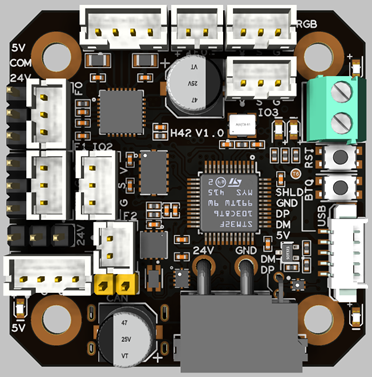
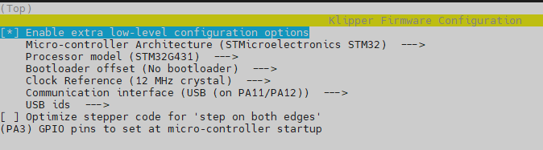
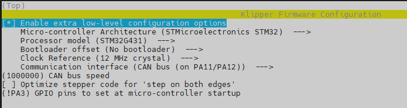

# H42_Combo

The H42_V1.0 is a versatile control board designed for Klipper firmware. Powered by an STM32G431CBT3 microcontroller, it offers excellent real-time control performance and expandability. It supports both CAN Bus and USB communication, meeting connectivity requirements across various system architectures.

Regarding communication and peripheral expansion, the H42_V1.0 features an onboard USB 2.0 hub, facilitating the connection and integration of various USB peripherals. Additionally, it includes an interface for an LDC1612-based inductive displacement sensor, enabling high-sensitivity, non-contact displacement detection.

When operating in CAN communication mode, the H42_V1.0 supports an ambient operating temperature of up to 125°C, making it well-suited for applications that demand high thermal tolerance and system stability.

> [!IMPORTANT] 
>- Since there is no 125 degree Celsius USB-HUB chip, the 125 degree Celsius operating environment is limited to CANBUS mode；
Klipper currently does not support 125 degree Celsius accelerometers, so the 125 degree Celsius operating environment does not include accelerometers. The default version of H42 is ADXL345, which has a maximum operating temperature of 85 degrees Celsius. The 105 degree Celsius ADXL345-EP version is optional, but it is more expensive

# Features
**Powerful Control and Reliable Hardware**

- **STM32G431CBT3 MCU** with support for **Klipper firmware**, providing reliable real-time control performance.
- **6-layer PCB design** with solid-state and tantalum capacitors for improved signal integrity, power stability, and long-term reliability.
- Onboard **CAN/USB communication** switch for flexible system integration.
- Onboard **RESET and BOOT0 buttons** for convenient system control and firmware updates.
- Fan-control and heater circuits **use independent high-power MOSFETs**, helping improve operational safety and reduce heat generation.
- Onboard **5 V/3 A DC-DC power module**, with peak 5V output power of up to **15W**.
- **XT30 power connector** with a customized cable included for secure and reliable high-current connections.

**Flexible Connectivity and Expansion**

- Onboard **USB 2.0 HUB** with **two USB 2.0 ports**, one of which is directly connected to the MCU.
- Supports both **CAN Bus and USB 2.0 communication**.
- Onboard **USB-C connector** for convenient firmware updates.
- Onboard **TMC2209 stepper motor driver** for quiet and precise motor control.

**Rich Peripheral Interfaces**

- 2 × 3-pin fan connectors
- 1 × 2-pin fan connector
- 4 × level-shifted IO interfaces
- 1 × RGB interface
- 1 × heater output
- 1 × thermistor interface
- 1 × status indicator LED

**Integrated Sensors**

- Onboard **LDC1612 eddy-current sensing circuit** for high-sensitivity, non-contact displacement detection.
- Onboard **ADXL345 accelerometer** for motion monitoring, vibration analysis, and related calibration applications.
  
# Application

- Voron AfterBurner Head
- NEMA 17 Stepper Motors Head

## Flashing for Klipper

### USB 

- [*] Enable extra low-level configuration options 
- Micro-controller Architecture (STMicroelectronics STM32)
- Processor model (STM32G431)
- Bootloader offset (No bootloader)
- Clock Reference (12 Mhz crystal)
- Communication interface (USB (on PA11/PA12))
- USB ids (leave default)
- (PA3) GPIO pins to set at micro-controller startup

### CAN

- [*] Enable extra low-level configuration options 
- Micro-controller Architecture (STMicroelectronics STM32)
- Processor model (STM32G431)
- Bootloader offset (No bootloader)
- Clock Reference (12 Mhz crystal)
- Communication interface (CAN bus (on PA11/PA12))
- (1000000) CAN bus speed
- (!PA3) GPIO pins to set at micro-controller startup

